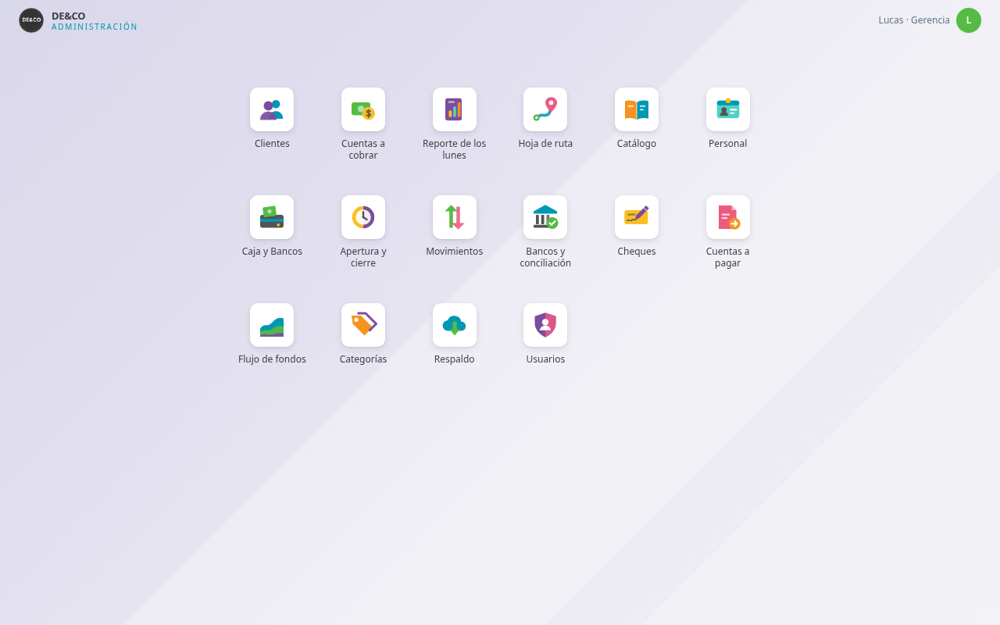
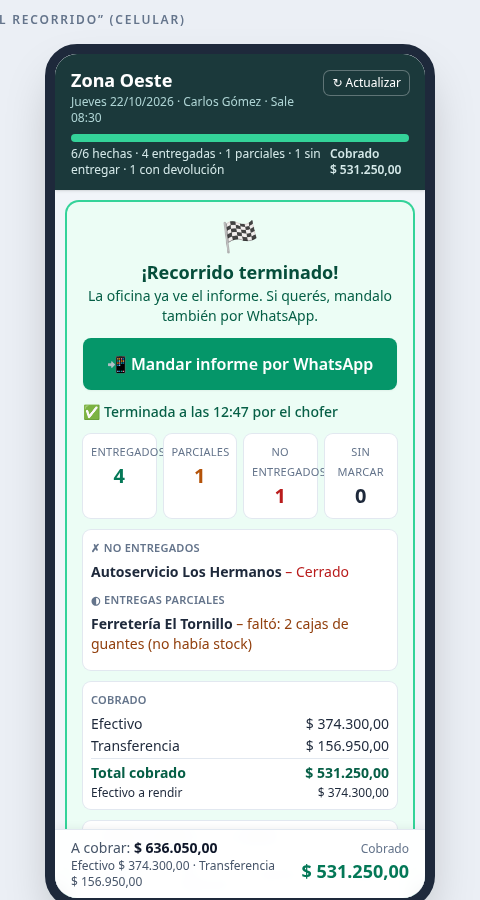
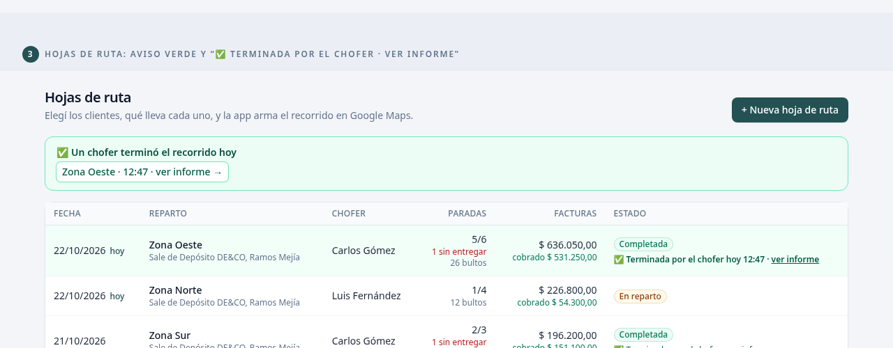

# DE&CO · Panel Administrativo

> Sistema de gestión interno **en uso real** por una distribuidora chica de Córdoba (DE&CO). Junta en una sola web lo que antes estaba repartido en planillas de Excel, papeles y grupos de WhatsApp: clientes, cobranzas, reparto, tesorería, personal, catálogo y permisos.

🟢 **En producción (requiere login):** https://deco-admin.vercel.app
_Las cuentas son del personal de la empresa; no hay usuario de demo público. Para probarlo, levantalo con tu propio Supabase y los datos de ejemplo de `supabase/seed_demo.sql` (ver abajo)._



## ¿Qué resuelve?

El equipo administrativo de la empresa necesitaba saber, todos los días: **quién debe, quién pagó, qué sale en el camión, cuánta plata hay en cada cuenta y quién está de vacaciones**. Este panel lo responde en una pantalla, con reglas de negocio validadas en la base de datos (no solo en el front) y con permisos por rol para que cada persona vea solo lo suyo.

## Funcionalidades

| Módulo | Qué hace |
|---|---|
| **Clientes** | Alta y edición con validación de CUIT, estados (activo / pendiente / inhabilitado), importación desde Excel |
| **Cuentas a cobrar** | Importa el Excel del sistema contable (Sintesys) sin duplicar, promesas de pago, pagos informados a validar, gestiones y "Reporte de los lunes" |
| **Hoja de ruta / reparto** | Arma el recorrido en Google Maps, ordena las paradas solo, genera un **link para el chofer** que marca cada parada (entregado / parcial / no entregado), devoluciones, horarios por cliente, **lectura automática del PDF de la factura** (monto y comprobante), hoja impresa e informe por WhatsApp |
| **Tesorería** | Un solo libro para caja y bancos, cheques y e-cheq, apertura y cierre diario por jornada, conciliación de extractos bancarios y flujo de fondos con simulaciones |
| **Cuentas a pagar** | Obligaciones importadas o manuales, en cuotas, con decisión de Gerencia antes de pagar |
| **Personal** | Legajos, vacaciones según la LCT con saldo, novedades con aprobación y calendario anual exportable a PDF, iCal y Excel |
| **Catálogo** | Productos con fotos, rubros y subrubros, importación desde Excel y catálogo PDF A4 con el estilo de la marca |
| **Seguridad** | Roles (gerencia, administración, ventas), **permisos por sección aplicados en RLS** con `puede_ver()`, auditoría de cambios y respaldo en Excel/JSON |

<p align="center">
  
  &nbsp;
  
</p>

_Capturas con datos de ejemplo._

## En números

- **29 tablas** en Postgres, **todas con Row Level Security**.
- **Más de 10 módulos** usados a diario por el personal administrativo, de ventas y los choferes.
- **19 migraciones** SQL versionadas (`supabase/`).
- Iteración rápida con las usuarias: decenas de cambios pedidos por WhatsApp y desplegados en pocos días.

## Stack

- **Next.js 14** (App Router) · **React 18** · **TypeScript** · **Tailwind CSS**
- **Supabase**: Postgres, Auth, RLS, funciones y triggers en SQL
- **Vercel** para el hosting
- **pdfjs-dist** para leer facturas PDF · **SheetJS (xlsx)** para importar y exportar Excel
- OpenStreetMap (geocodificación) y Google Maps (recorridos)

## Cómo correrlo

1. Creá un proyecto en [Supabase](https://supabase.com).
2. En **SQL Editor**, corré `supabase/schema.sql` y después las migraciones `migracion_02` a `migracion_19`, en orden.
3. (Opcional) Corré `supabase/seed_demo.sql` para cargar clientes y productos **inventados**.
4. Configurá las variables y levantá la app:

```bash
npm install
cp .env.example .env.local   # completá con los datos de TU proyecto Supabase
npm run dev                  # http://localhost:3000
```

5. Registrate desde la pantalla de ingreso: **la primera cuenta queda como Gerencia**; las siguientes quedan pendientes hasta que Gerencia les asigne rol.

Tests del lector de facturas (con PDFs de ejemplo generados por `scripts/generar-facturas-prueba.py`):

```bash
npm run test:facturas
```

### Variables de entorno

| Variable | Para qué |
|---|---|
| `NEXT_PUBLIC_SUPABASE_URL` | URL del proyecto Supabase |
| `NEXT_PUBLIC_SUPABASE_ANON_KEY` | Clave pública (anon) |
| `SUPABASE_SERVICE_ROLE_KEY` | Solo servidor, para el feed iCal. **Nunca** con prefijo `NEXT_PUBLIC_` |
| `ICAL_TOKEN` | Opcional, clave para suscribirse al calendario de personal |

## Documentación

El manual completo de uso (reglas de negocio, tesorería, conciliación, flujo de fondos, hoja de ruta, importaciones) está en [`docs/MANUAL.md`](docs/MANUAL.md).

## Privacidad

Este repositorio **no contiene datos reales**: ni clientes, ni facturas, ni movimientos, ni credenciales. Los PDFs de `scripts/facturas-prueba/` y los datos de `seed_demo.sql` son inventados. El historial de git es nuevo y no incluye versiones anteriores.

---

Hecho por [Lucas](https://github.com/ttt13412014) · Córdoba, Argentina
